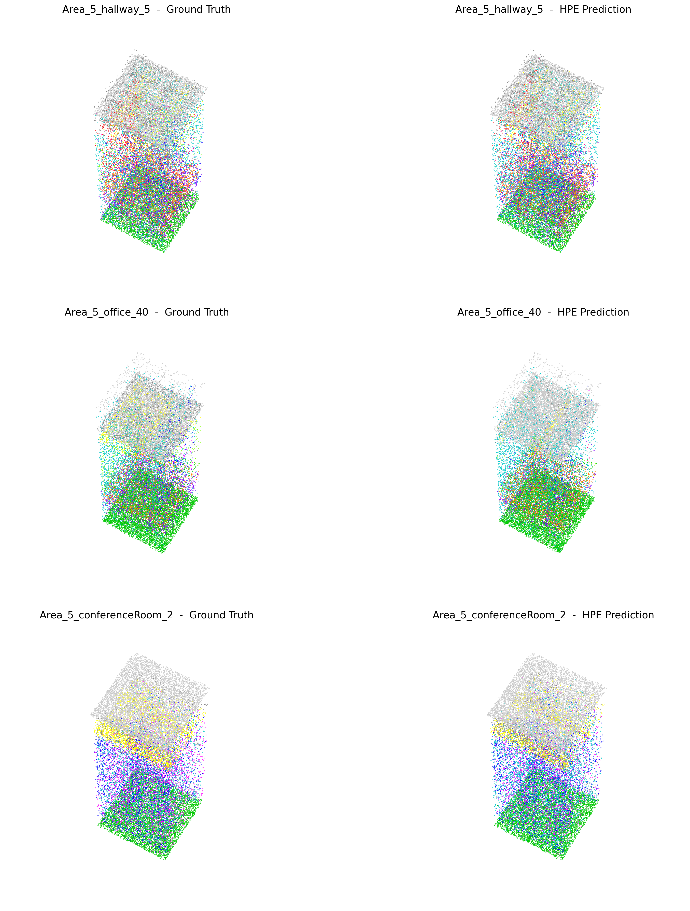

# HPE-PEFT

Official implementation of

> **HPE-PEFT: Hierarchical Point Encoding for Parameter-Efficient Fine-Tuning via
> Group Geometry on the Positional Pathway**
>
> Dongfang Zhang, Kaizhe Feng, Wei Gong

Submitted to *Pattern Recognition* (Virtual Special Issue: *Adaptive and Scalable
Vision Models in Dynamic and Resource-Constrained Environments*).

<p align="center">
  
</p>

[](https://github.com/fkz1103/HPE-PEFT)
[](https://huggingface.co/fkz1103/HPE-PEFT-ckpts)
[](LICENSE)

## Highlights

- **Hierarchical Point Encoding (HPE)**: a 10-dimensional *group geometry* descriptor
  (relative coordinates, pairwise distance, group mean, group standard deviation) is
  injected into the **positional pathway** of every transformer block, so that local
  geometry reaches all layers without touching the frozen backbone.
- **Group-level, not token-level**: the encoding is computed once per point group and
  shared across the whole network, giving a cost that is independent of depth.
- **Parameter efficiency**: only **1.38%–1.40%** trainable parameters on
  classification tasks and **4.30%–4.34%** on segmentation tasks.

## Results

| Dataset | Metric | Ours | Full fine-tuning | Trainable params |
|---|---|---|---|---|
| ModelNet40 | OA / mAcc | **93.35 / 90.33** | 92.99 / 90.57 | 310.3K (**1.40%**) |
| ScanObjectNN (PB-T50-RS) | OA / mAcc | **79.90 / 77.21** | — | 303.9K (**1.38%**) |
| ShapeNetPart | Part-mIoU | **81.32** | 81.22 | 0.99M (**4.34%**) |
| S3DIS (Area 5) | mIoU / OA | **62.12 / 88.05** | 68.18 / 89.12 | 0.98M (**4.30%**) |

## Environment

Tested with Python 3.10, CUDA 11.8, PyTorch 2.x on a single RTX 4080 Super (16 GB).

## Installation


```bash
conda create -n hpe python=3.10 -y
conda activate hpe

pip install torch==2.0.1 torchvision==0.15.2 --index-url https://download.pytorch.org/whl/cu118
pip install -r requirements.txt

# build the CUDA extension (chamfer distance)
cd extensions/chamfer_dist
python setup.py install
cd ../..
```

> `pointnet2_ops` and `knn_cuda` are required by the Point-MAE backbone. Please build
> them following the instructions of the original
> [Point-MAE](https://github.com/Pang-Juzhong/Point-MAE) repository.

## Data preparation

All dataset paths are defined in `cfgs/dataset_configs/*.yaml`. Put the raw data
under `data/` as follows:

| Dataset | Source | Expected location |
|---|---|---|
| ModelNet40 | https://shapenet.cs.stanford.edu/media/modelnet40_normal_resampled.zip | `data/ModelNet40/` |
| ScanObjectNN | https://hkust-vgd.github.io/scanobjectnn/ (`main_split`, h5) | `data/ScanObjectNN/` |
| ShapeNetPart | https://shapenet.cs.stanford.edu/media/shapenetcore_partanno_segmentation_benchmark_v0_normal.zip | `data/ShapeNetPart/` |
| S3DIS | http://buildingparser.stanford.edu/dataset.html | `data/s3dis/` |

See `DATASET.md` for the per-dataset preprocessing details.

> The datasets are **not** redistributed here because of their licenses
> (S3DIS is CC BY-NC-ND). Please download them from the official sources above.

## Pre-trained backbone

Download the Point-MAE pre-trained weights (`pretrain.pth`) from the
[official repository](https://github.com/Pang-Juzhong/Point-MAE) and place it at
`pretrained/pretrain.pth`.

## Our checkpoints

The fine-tuned checkpoints reported in the paper are hosted on Hugging Face:

**https://huggingface.co/fkz1103/HPE-PEFT-ckpts**

| File | Dataset | Trainable | Result |
|---|---|---|---|
| `hpe_modelnet40.pth` | ModelNet40 | 310.3K (1.40%) | 93.35 OA / 90.33 mAcc |
| `hpe_scanobjectnn.pth` | ScanObjectNN-Hardest | 303.9K (1.38%) | 79.90 OA / 77.21 mAcc |
| `hpe_shapenetpart.pth` | ShapeNetPart | 0.99M (4.34%) | 81.32 Part-mIoU |
| `hpe_s3dis.pth` | S3DIS (Area 5) | 0.98M (4.30%) | 62.12 mIoU / 88.05 OA |
| `hpe_ablation_b16.pth` | ModelNet40 | — | bottleneck dim b = 16 |
| `hpe_ablation_b32.pth` | ModelNet40 | — | bottleneck dim b = 32 |
| `hpe_ablation_b128.pth` | ModelNet40 | — | bottleneck dim b = 128 |

## Reproduce

```bash
# ModelNet40 classification       (1.40% trainable, 93.35% OA)
python main.py --config cfgs/peft_hpe_modelnet40.yaml \
               --exp_name hpe_modelnet40 --ckpts pretrained/pretrain.pth

# ScanObjectNN-Hardest classification  (1.38% trainable, 79.90% OA)
python main.py --config cfgs/peft_hpe.yaml \
               --exp_name hpe_scan --ckpts pretrained/pretrain.pth

# ShapeNetPart part segmentation  (4.34% trainable, 81.32 Part-mIoU)
python main_seg.py --config cfgs/shapenet_part_seg.yaml --exp_name hpe_shapenetpart

# S3DIS semantic segmentation     (4.30% trainable, 62.12 mIoU on Area 5)
python main_seg.py --config cfgs/s3dis_seg_hpe.yaml --exp_name hpe_s3dis
```

### Bottleneck-dimension ablation

```bash
python main.py --config cfgs/peft_hpe_ablation_b16.yaml  --exp_name abl_b16
python main.py --config cfgs/peft_hpe_ablation_b32.yaml  --exp_name abl_b32
python main.py --config cfgs/peft_hpe_ablation_b128.yaml --exp_name abl_b128
```

## Parameter counting

The numbers in the parameter-composition table can be reproduced with:

```bash
python count_bottleneck_params.py   # HPE encoder: N_HPE = (5/2)b^2 + (D+18)b + D + 4
python count_seg_params.py          # + per-layer scale/shift: N_mod = 2LD
```

## Repository structure

| Path | Description |
|---|---|
| `models/hpe_peft.py` | HPE encoder + PEFT wrapper (core of this paper) |
| `models/peft.py` | PEFT variants (LoRA, SSF, Adapter, VPT) used as baselines |
| `models/Point_MAE.py` | Point-MAE backbone with the positional-pathway hook |
| `models/segmentation.py` | Segmentation head + per-layer modulation |
| `cfgs/` | Training configurations |
| `datasets/` | Dataset loaders |
| `tools/`, `utils/` | Runner, logging, distributed helpers |
| `extensions/` | CUDA extension (chamfer distance) |
| `eval_*.py` | Evaluation scripts |
| `vis_*.py`, `paper_figures.py` | Figure generation scripts |

## Citation

```bibtex
@article{zhang2026hpepeft,
  title   = {HPE-PEFT: Hierarchical Point Encoding for Parameter-Efficient
             Fine-Tuning via Group Geometry on the Positional Pathway},
  author  = {Zhang, Dongfang and Feng, Kaizhe and Gong, Wei},
  journal = {Pattern Recognition},
  year    = {2026},
  note    = {Under review}
}
```

## Acknowledgements

This work was supported by the China Postdoctoral Science Foundation
(No. GZC20232463), the Postdoctoral Project of Hubei Province (No. 2024HBBHCXA091),
and the Joint Open Fund of Research Platforms of the School of Computer Science,
China University of Geosciences (Wuhan) (No. PTLH2024-B-12).

## License

MIT — see [LICENSE](LICENSE). This repository builds upon
[Point-MAE](https://github.com/Pang-Juzhong/Point-MAE).
